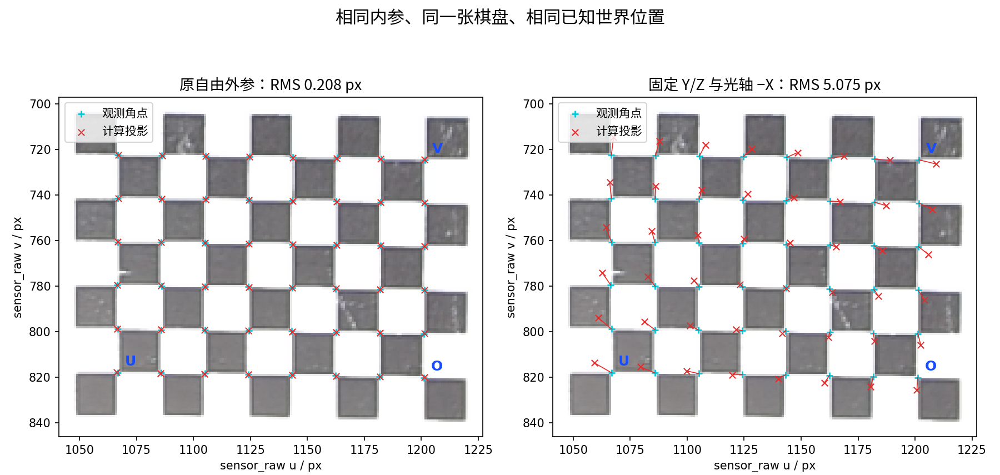

# 相机标定与滑杆定位实验资料 · 2026-11-17

本目录保存本轮本机内参标定、世界外参求解、最近实拍验证及严格安装约束重求的完整资料与图片。它是实验归档，所有候选参数均不自动应用到机械臂。

**最新结论：用户确认的机械位置和O/U/V坐标作为固定输入后，现有内参下的严格外参解未通过验证。不要把失败解当成可直接替换的运行配置。**

## 当前确认的坐标及约束

- 世界系为左手系：+X橙杆→蓝杆；+Y基点朝导轨；+Z竖直向上。
- 基点S=(65,26.5,−64.8)mm。局部机械臂模型保持原右手系：x=65−X、y=Y−26.5、z=Z+64.8。
- 用户确认光心Y=97、Z=−102.8mm，光轴严格世界−X；O=(9.2,174.4,−25.8)、U=(9.2,132.4,−25.8)、V=(9.2,174.4,−55.8)mm可信。
- 实际相机video31/m01、1920×1080 sensor_raw；8×6内角点、6mm棋盘。34张内参fx716.218990/fy709.895404/cx962.403066/cy549.185229。
- 旧地面实拍仅第1、2、5张用于验证；第3、4张按用户要求排除，不包含其原图或初步结果。

## 结果顺序

|阶段|主要结果|报告|
|---|---|---|
|30张本机内参与首次世界外参|候选0优于1；内参覆盖不足|[过程与候选检查](diagnostics/calibration_review_20261117/标定检查与候选选择.md)|
|首次新内外参回放实拍|6点X平均绝对误差2.384mm，最大2.985mm|[实拍验证](diagnostics/new_calibration_photo_test_20261117/新标定地面实拍测试报告.md)|
|34张重新标定内参|9区覆盖，RMS0.334px；不是毫米精度认证|[内参检查](diagnostics/intrinsics_v3_review_20261117/内参检查报告.md)|
|配套新自由外参|候选0，棋盘RMS0.208px；实拍MAE1.980mm|[新外参验证](diagnostics/new_extrinsics_v3_photo_test_20261117/新外参检查与实拍验证.md)|
|基点最新更正|−64.5→−64.8，仅局部Z再增加0.3mm|[基点更正](diagnostics/base_world_correction_20261117/基点更正说明.md)|
|光心与光轴约束对照|直接拼接Y/Z改善杆X但破坏棋盘重投影一致性|[约束对照](diagnostics/camera_pose_constraints_20261117/光心与光轴约束对照.md)|
|用户确认约束后正式重求|Cx222.423、棋盘RMS5.075px、实拍MAE9.820mm；未通过|[最新严格求解](diagnostics/strict_mount_extrinsics_20261117/严格安装约束外参重求结果.md)|

历史阶段对棋盘姿态的疑问按原记录保留；最新求解已经按用户确认接受几何输入。各阶段结果不得混用或视作已部署状态。详见[过程记录](EXPERIMENT_HISTORY.md)。

## 图片与原始材料

- [34张内参原图及角点](raw_calibration/intrinsics_v3/)；[30张前版原图及角点](raw_calibration/intrinsics_v2/)。两组共64张原始PNG，原样保存。
- [地面实拍第1/2/5张原PNG及原备注](diagnostics/photo_redetect_76459ec8_20261117/input/session_20260510_222231_76459ec8/)。原JSON的旧reference_geometry是历史元数据，计算使用各报告明确列出的新参数。
- [首次世界棋盘原图及角点](diagnostics/calibration_review_20261117/board_evidence/world_pose_f471d02363658eb2/)；[最新世界棋盘原图及角点](diagnostics/new_extrinsics_v3_photo_test_20261117/board_evidence/)。
- [新外参实拍标注图](diagnostics/new_extrinsics_v3_photo_test_20261117/新外参实拍检测对照.jpg)；[严格约束重投影对照](diagnostics/strict_mount_extrinsics_20261117/棋盘约束重投影对照.png)。
- [世界位置草图与镜头参考照片](reference_images/)；草图旧数值以最新文字确认值为准。
- [A4每格6mm打印棋盘](targets/checkerboard_6mm_8x6_A4.pdf)；[O/U/V认点示意](targets/checkerboard_OUV_guide.pdf)。打印用前者，100%实际大小并核实尺寸。

## 复核与文件说明

JSON/CSV保留逐点结果、拟合条件、来源哈希与失败状态；raw_calibration保存完整采样角点和原图。历史脚本保留作计算记录，可能引用原工作区路径。独立的[离线复核入口](tools/reproduce.py)可从本目录重算最新自由外参与严格约束结果：

```sh
python3 tools/reproduce.py
```

需要Python、NumPy、OpenCV和SciPy。它只读归档原图并在reproduction_results/输出结果，不打开相机或串口。arm_real_control/是本轮用到的最小离线源码快照，不是运行入口；实际项目程序仍位于仓库根目录。

本归档不含SSH登录助手、密码/密钥、模型权重、缓存、重复压缩包和无关旧运动录像。所有原始图片保持字节不变；发布副本仅将Markdown绝对文件链接改为GitHub相对链接。[archive_manifest.json](archive_manifest.json)给出归档SHA256及原文件来源校验。


